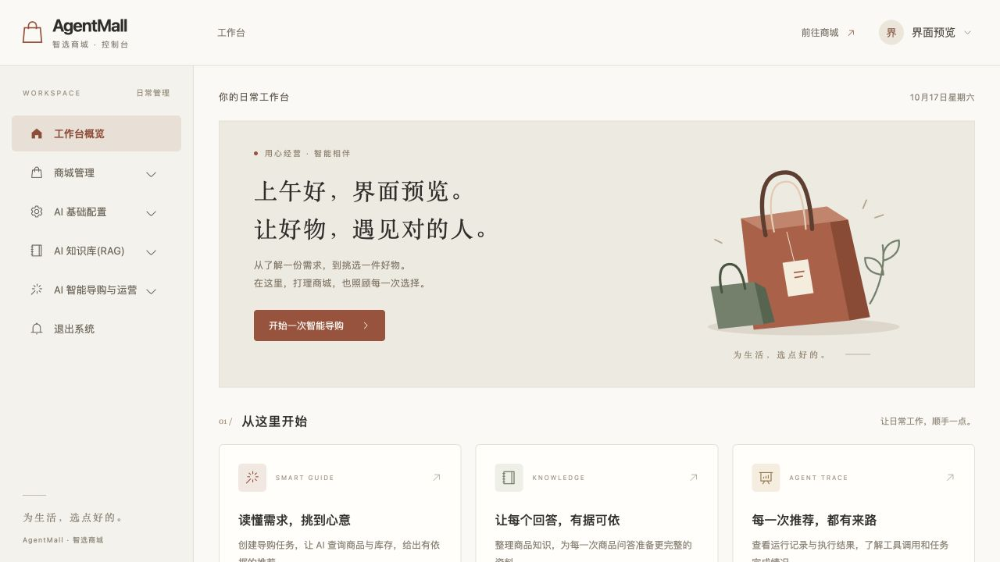

AgentMall 部署成功后，我打开后台，发现了一件不对劲的事：登录页已经是暖白和砖红的风格，进去之后却还是原来的后台。

这正是我之前提出过的问题。当时我觉得登录页和控制台之间割裂感太强，已经让 AI 协助统一过界面，也看过改版后的效果。

既然改过，为什么上线之后又变回去了？

最后查明，修改没有消失，也不是服务器把新版本覆盖成了旧版本。**那份后台改版留在另一个云端聊天的工作区里，没有提交到 GitHub，自然也没有进入这次部署。**

## 1. 自动部署成功，不等于想要的修改已经发布

这次最容易误判的地方，是自动部署本身已经正常工作。

GitHub Actions 显示成功，服务器镜像版本与 GitHub 的 `main` 分支也一致。按照这两项检查，似乎可以说“已经部署最新代码”。

但这里少了一个问题：**我要的那份修改，真的在 `main` 里吗？**

自动部署只处理它能拿到的仓库内容。另一台机器上尚未提交的文件，不会因为流水线变绿，就自动出现在镜像里。

这次的实际链路是：

```text
云端工作区：有后台 UI 修改，但未提交
                      ↓ 缺少提交与推送
GitHub main：没有这份后台 UI 修改
                      ↓ 自动构建与部署成功
服务器：正确运行了仓库里的旧后台界面
```

所以，之前“GitHub 与服务器版本一致”的结论没有错，但不足以回答“我改过的界面是否上线”。协助部署时漏查了云端工作区里的未提交修改，这是本次漏发布的直接原因。

## 2. 先定位修改在哪，再考虑重新构建

排查时，我没有先让服务器反复重启，也没有一开始就清浏览器缓存，而是先把几个位置分开核对。

| 位置 | 要确认的事情 | 本次发现 |
| --- | --- | --- |
| 本机项目 | 当前分支、未提交改动、最新提交 | 本机 `main` 与远端一致，工作区干净 |
| 本机旧分支 | 是否保留了那次 UI 改版 | 找到一个名称相关的分支，但内容并非目标改版 |
| GitHub | 发布分支究竟包含什么代码 | 登录页改动已进入，后续后台改版未进入 |
| 服务器 | 当前实际运行哪个提交的镜像 | 与当时的 `main` 一致 |
| 原云端聊天 | 当时到底改了哪些文件 | 找到原始修改记录，确认没有提交、推送 |

这里还有一个小坑：看到一个叫“界面改版”的旧分支，很容易以为答案就在里面。实际比较以后才发现，它与目标改版不是一回事。**分支名只能提供线索，文件差异才是证据。**

类似问题可以先用这些 Git 命令查看状态；下面是排查思路示例，不是要求直接执行整段脚本：

```bash
git status --short
git branch -vv
git log --oneline --all -- vue/src/views/Manager.vue
git diff main..某个待核对的分支 -- vue/src/views/Manager.vue
```

`git status` 干净，只能说明当前这个工作区没有未提交修改。它不能证明其他电脑、其他副本或云端会话里也没有修改。

## 3. 从原始记录恢复，而不是重新设计一遍

找到原云端聊天后，可以确认当时的改版主要涉及三个文件：

| 文件 | 原改版负责的内容 |
| --- | --- |
| `vue/src/views/Manager.vue` | 后台框架、侧栏、账号菜单和手机导航 |
| `vue/src/views/manager/Home.vue` | 工作台首页、购物袋插画和业务入口 |
| `vue/src/assets/css/manager.css` | 后台统一配色、表格与表单样式 |

这次恢复的目标，是把已经确认过的设计找回来，因此没有另起一套 UI。

具体操作是从原聊天中提取这三个文件的修改记录，先检查内容，再在独立的本地项目副本里恢复。没有把聊天中记录的整段命令不加检查地重新执行，也没有把旧数据库文件一起带进来。

恢复后的后台沿用了登录页的暖白底色、砖红主色和购物袋元素，重新整理了工作台入口，并为手机端提供可展开、关闭的导航。



这张图是本地模拟账户的预览，用于展示布局，不包含真实账户资料。

## 4. 先验证界面，再提交发布

文件恢复以后，先做了两类检查。

第一类是源码与构建检查：确认差异只涉及目标文件，没有混入私有 SQL 或其他个人数据，并使用与线上一致的接口前缀构建前端：

```bash
git diff --check

# 在前端目录执行
VITE_BASE_URL=/api npm run build
```

这次本机 Docker 守护进程没有运行，所以本地先完成前端生产构建；真正的 Linux amd64 镜像随后由 GitHub Actions 构建。两项验证各自说明不同的事情，不能把本地前端构建通过，直接当成服务器镜像已经可用。

第二类是浏览器检查：查看桌面和手机布局，展开账号菜单，测试手机侧栏，以及从首页进入商品管理页面。

这些检查使用临时模拟账户和本地测试接口。模拟数据只用来验证布局与导航，不能代替真实登录、接口和数据持久化验收。测试页面、测试配置和模拟账户都没有提交到 GitHub。

## 5. 补交到 main，让已有流水线完成发布

确认恢复内容后，实际提交了上述三个界面文件：

```text
提交：c483c42
说明：fix(ui): restore warm console design matching login
```

这次通过 GitHub 连接工具创建提交，并在确认远端分支仍指向预期旧提交后更新 `main`，避免覆盖过程中出现的其他提交。没有强制推送，也没有把整个旧工作区打包覆盖到仓库。

提交进入 `main` 后，已有自动部署工作流依次完成：

```text
构建 Linux amd64 前后端镜像
    → 打包发布产物
    → 上传服务器
    → 更新应用容器
    → 执行上线检查
```

本次继续使用已经配置好的部署授权，没有重新添加临时 SSH 密钥，也没有重新配置 GitHub Secret。

发布后，再把本机原项目快进同步到同一提交。这样，本机、GitHub 和服务器才真正对应上了这次恢复后的代码。

## 6. 最后验收不能只看绿色对勾

这次验收特意补上了之前缺失的“目标修改是否真的在线上”这一环。

先检查服务器发布记录，确认提交已经从旧版本切换为 `c483c42`；再检查前端容器的镜像标签，以及实际提供的资源中是否包含新版工作台的内容。最后从公网打开后台，确认页面已经显示新版侧栏、工作台和插画。

随后检查业务是否仍然正常：

- 管理员重新登录通过。
- 登录后的商品查询通过。
- 上传、下载以及重启后的文件持久化检查通过。
- 数据库容器没有被替换，同机运行的 Hermes 服务仍然正常。

这些结果证明了本次界面更新已经发布，且没有破坏已检查的基础功能。它们并不代表所有业务功能都完成了测试，真实模型调用仍需在配置相应密钥后单独验证。

## 7. 以后怎么避免再漏一次

这次之后，我会把“做完了”的判断拆得更具体：

1. **文件已修改**：改动在哪个工作区，涉及哪些文件。
2. **代码已提交**：能够给出对应的提交号。
3. **代码已进入发布分支**：目标修改确实包含在 `main` 中。
4. **发布已完成**：流水线成功，服务器实际运行对应镜像。
5. **效果已确认**：公网页面展示了预期变化，相关功能验收通过。

跨本机与云端协作时，还要额外写清楚文件位置。云端预览完成、本机保存完成、GitHub 提交完成和服务器上线完成，是四个不同的状态。

这次没有复杂的运行时故障，问题出在交接与版本追踪上。把提交号、镜像版本和公网效果串起来以后，才终于回答了最开始的那个问题：我改过的界面，现在确实上线了。
